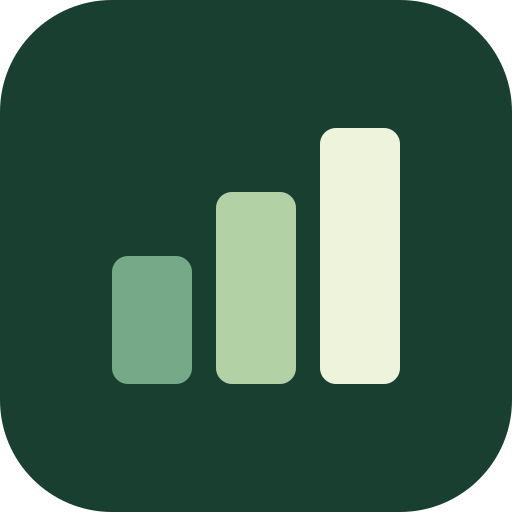
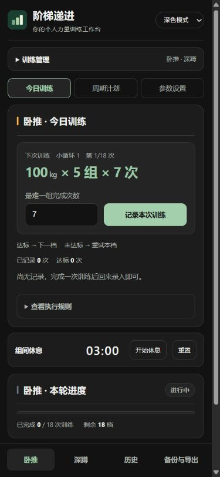
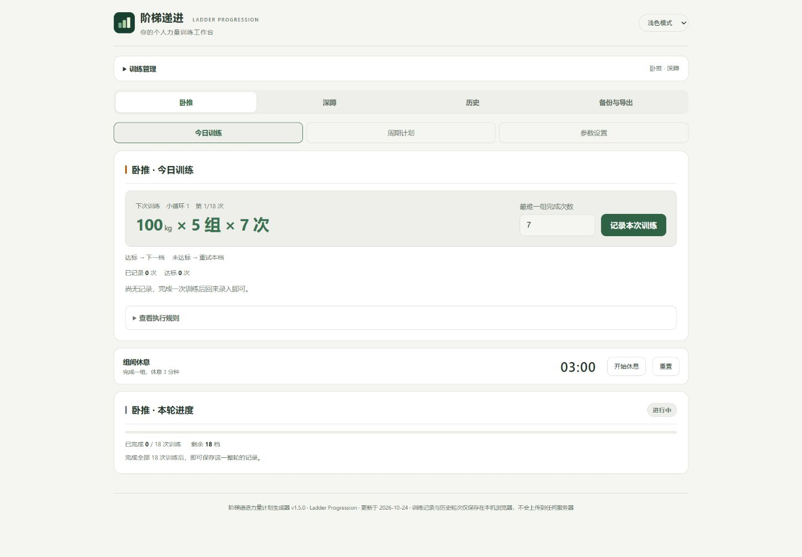

<div align="center">
  
  <h1>阶梯递进</h1>
  <p><strong>Ladder Progression · 个人力量训练工作台</strong></p>
  <p>从你的 10RM 出发，让计划跟上每一次进步。</p>
  <p>
    <a href="https://yemijun.github.io/ladder-progression/"><strong>打开在线版 ↗</strong></a>
    · <a href="#三步开始">使用指南</a>
    · <a href="#本地开发">本地开发</a>
    · <a href="#数据备份">数据备份</a>
  </p>
  <p>   </p>
</div>

## 界面预览

<table>
  <tr>
    <th width="28%">手机版 · 深色模式</th>
    <th width="72%">电脑版 · 浅色模式</th>
  </tr>
  <tr>
    <td align="center" valign="top">
      <a href="docs/preview-mobile.jpg"></a>
    </td>
    <td align="center" valign="top">
      <a href="docs/preview-desktop.jpg"></a>
    </td>
  </tr>
</table>

点击截图可查看原图。两端均支持跟随系统、浅色和深色模式。

## 把精力留给训练

输入卧推或深蹲的 10RM，自动生成四个小循环。每次练完录入实际次数，后续计划随即更新：达标前进，未达标重试，连续未达标则退阶。

| 能做什么 | 使用体验 |
| :--- | :--- |
| 按需启用动作 | 卧推、深蹲各自有开关；只练一个，就关闭另一个。记录与设定保留，重新开启即可继续。 |
| 独立递进 | 两个动作各自设置、排期、打卡，互不影响。 |
| 组间休息 | 三分钟计时器，支持暂停、继续和重置。 |
| 跟随系统 | 自动响应设备深浅模式，也可手动固定浅色或深色。 |
| 离线训练 | 首次联网加载并完成缓存后，断网也能使用；支持添加到主屏幕。 |
| 留下训练轨迹 | 完整轮次归档，支持 PNG、CSV、打印 / PDF 与 JSON 备份。 |

## 三步开始

1. **选择动作**：展开顶部「训练管理」，启用卧推、深蹲或两者。关闭动作不会删除数据，历史轮次与完整备份仍可访问。手机底部导航可随时切换动作、历史与备份。
2. **设置基准**：选择「参数设置」，填写 10RM 和递增一档后的完成次数。测试方法和判定示例可展开查看。默认值仅作示例，请填写自己的实际数据。
3. **开始打卡**：「今日训练」只显示本次任务、计时器与进度，录入实际次数即可推进。执行规则、过往记录默认折叠；撤销操作位于展开后的「本轮训练记录」中。进入「周期计划」查看编排，需要时展开完整日程。

> **关闭与暂停的区别**：动作开关隐藏整个工作区及默认导出模块；「每周训练次数 → 暂停」保留工作区，但停止排期和打卡。两者都保留已有记录。

### 计划如何推进

| 本次结果 | 后续安排 |
| :--- | :--- |
| 达到目标次数 | 进入下一重量档 |
| 少于目标次数 | 重做当前重量档 |
| 同档连续未达标达到阈值 | 下调 5 个当前重量单位，从本小循环开把档重走 |

每档 **5 组**，组间休息 **3 分钟**。四个小循环的开把次数依次为 **7 / 8 / 9 / 10**，每递增一档次数减 2。连续未达标阈值可设为 1、2 或 3 次，最低训练重量为 5 个当前重量单位。

判定基于「断层 = 10 − 递增一档后完成次数」：卧推测试递增 5kg，深蹲测试递增 10kg。具体判定、跨度和示例可在各动作的「计划设置」查看。

> **计划来源**：训练模板来自抖音创作者 **小鸡仔**。本项目将其编排规则程序化，用于自动排期、记录和进退阶；计划本身的权利归原作者，如有异议请联系删除。

## 安装到手机

- **安卓**：使用支持 PWA 的浏览器打开在线版，从菜单选择「安装应用」或「添加到主屏幕」。提供 192 / 512 图标和独立 maskable 图标，适配不同桌面裁切形状。
- **iPhone / iPad**：在 Safari 中打开，选择「分享 → 添加到主屏幕」。提供 180 / 167 / 152 像素 Apple Touch 图标。
- **更换图标后**：系统可能保留旧图标。如需重新添加，先导出备份；不要清除网站数据。

### 深色模式下的底部白条

网页已启用 `viewport-fit=cover`，同步页面根背景、`color-scheme` 和动态 `theme-color`。深色模式采用中性炭黑，浅色采用柔和灰白；手机底部导航使用与根背景完全一致的不透明底色，并延伸至安全区域。无论滚动到哪一处，底缘均保持连续纯色，让支持透底或邻近取色的系统有稳定的背景参考。

邻近取色是对部分机型行为的兼容方向，并非对所有 Android 厂商取色算法的确认。该设计也不能绕过浏览器或系统强制的导航栏颜色。

**最底部导航区域仍由浏览器和 Android 控制**。部分版本的已安装 PWA 存在导航栏配色异常；网页不能保证覆盖所有机型的系统栏。若更新后仍出现白条，请先完全关闭应用后重开、检查浏览器更新，再反馈 Android 版本、浏览器版本和安装方式；避免通过清除网站数据排查。

参考：[Chrome 贴边显示说明](https://developer.chrome.com/docs/css-ui/edge-to-edge) · [Chromium 导航栏配色问题](https://github.com/GoogleChrome/android-browser-helper/issues/636)

## 导出与分享

在「备份与导出」中选择用途、动作和范围。内容来自点击生成时的数据快照，图片不受页面折叠状态影响。

| 用途 | 导出内容 |
| :--- | :--- |
| 训练卡 | 下一次训练的重量、组次、进度与休息提示；暂停或已完成时明确显示状态。 |
| 周期计划 | 已记录训练及后续安排，按动作、小循环分别出图；未来部分按全部达标推演。 |
| 本轮训练报告 | 仅包含实际录入的重量、目标次数、实际次数与结果。 |
| 自定义 | 自选计划参数、基准编排、训练日程和训练记录。 |

- **图片**：原生 Canvas 绘制，支持深浅配色与 1× / 2× / 3× 清晰度；每页最多 12 条，长内容自动分页并限制尺寸。先预览翻页，再保存单张或打包 ZIP；支持文件分享的设备会显示「系统分享」，也可尝试长按图片保存。
- **打印 / PDF**：使用独立的文字与表格文档，可从浏览器打印窗口存为 PDF；不改变训练页的折叠状态。
- **CSV**：分别导出训练计划或实际记录，使用所选动作和小循环范围。每行一条数据、固定列数，附 UTF-8 BOM，便于 Excel 打开。
- **历史轮次**：在「历史」中单独导出已归档轮次的图片、CSV 或归档 JSON，包括已关闭动作的历史。

## 数据备份

训练设定、当前记录与历史轮次只存于**当前设备、当前浏览器的 localStorage**。应用不上传训练数据，无账号、无后台同步；更换设备、浏览器或域名需要手动迁移。

- **导出**：「备份与导出 → 导出完整备份（JSON）」。完整备份包含关闭动作的数据、主题偏好和动作开关。
- **合并导入**：保留当前设定与开关，合并记录及历史轮次；重复导入同一文件不会重复添加。
- **覆盖导入**：按备份恢复设定、开关和全部记录，替换现有数据。旧版备份没有开关时，默认启用两个动作。
- **归档 JSON**：只包含所选历史轮次，导入时始终合并，不覆盖当前训练；旧版单独归档文件同样受到保护。迁移整机数据请使用完整备份。

清理浏览器数据可能导致记录丢失，请定期备份。离线缓存只保存应用资源，不能替代训练数据备份。

## 项目结构

```text
ladder-progression/
├── index.html                 # 页面结构与资源入口
├── manifest.webmanifest       # PWA 安装配置
├── sw.js                      # 应用离线缓存与更新
├── assets/
│   ├── css/app.css            # 基础组件和响应式布局
│   ├── css/workspace.css      # 紧凑工作区、主题与底部导航
│   ├── css/export.css         # 导出表单、图片预览与打印文档
│   ├── js/
│   │   ├── core.js            # 计划与进退阶计算、备份校验
│   │   ├── app.js             # 工作区、记录、主题与本机存储
│   │   ├── export-model.js    # 数据快照、分页、CSV 与 ZIP
│   │   ├── export-canvas.js   # 独立 Canvas 图片绘制
│   │   ├── export-ui.js       # 预览、下载、分享与打印
│   │   ├── theme-init.js      # 首次绘制前解析主题
│   │   └── register-sw.js     # 注册离线缓存
│   └── icons/                 # SVG 与安卓 / 苹果图标
├── docs/                      # README 手机及电脑界面截图
├── scripts/
│   ├── serve.cjs              # 本地静态预览服务器
│   └── generate-icons.ps1     # Windows 图标重建脚本
├── tests/                     # Node 内置测试，无测试依赖
├── .nojekyll                  # GitHub Pages 跳过 Jekyll 的空标记
└── LICENSE
```

## 本地开发

原生 HTML、CSS 与 JavaScript，**零第三方运行依赖，零构建步骤**。本地预览与测试需要 Node.js。

```bash
git clone https://github.com/yemijun/ladder-progression.git
cd ladder-progression
node scripts/serve.cjs
```

访问终端显示的本地地址。运行检查：

```bash
node --test tests/*.test.cjs
```

图标矢量源位于 `assets/icons/icon.svg`。在 Windows PowerShell 中运行 `./scripts/generate-icons.ps1`，可按相同几何配置重建 PNG。修改图标几何时，应同步更新 SVG 与生成脚本。

### 部署与更新

当前发布到 **GitHub Pages**。也可将 `index.html`、`assets/`、`manifest.webmanifest`、`sw.js` 和 `.nojekyll` 一起上传到静态托管服务。

- 不需要后端、数据库、依赖安装或构建。
- Service Worker 和安装能力需要 **HTTPS 或 localhost**。
- 修改资源后，同步更新资源版本、`sw.js` 缓存版本与预缓存列表；新增的运行资源必须加入列表。
- 页面联网优先，断网回退缓存；静态资源按版本缓存，只清理本应用的旧缓存。
- 源码已按目录拆分，离线使用请安装完整 PWA；单独下载 `index.html` 不再包含全部资源。

## 版本记录

| 版本 | 更新 |
| :--- | :--- |
| **1.6.0** | 训练卡 / 周期计划 / 报告导出、分页预览与 ZIP、独立打印文档、规范 CSV、归档导入保护 |
| 1.5.0 | 今日训练 / 周期计划 / 参数设置分屏、折叠规则与记录、中性色主题和纯色底部导航 |
| 1.4.0 | 动作启用开关、安全区域与系统配色适配、源码目录整理及新版文档 |
| 1.3.0 | 阶梯图标、安卓 / 苹果桌面图标、跟随系统主题 |
| 1.2.0 | 训练工作台改版、打卡置顶、休息计时器、输入和备份校验 |

## 许可与声明

代码采用 [MIT License](LICENSE)。训练模板来源见上文；本工具仅供参考，不构成训练或医疗建议，请根据自身情况评估训练强度，动作标准优先于重量。

